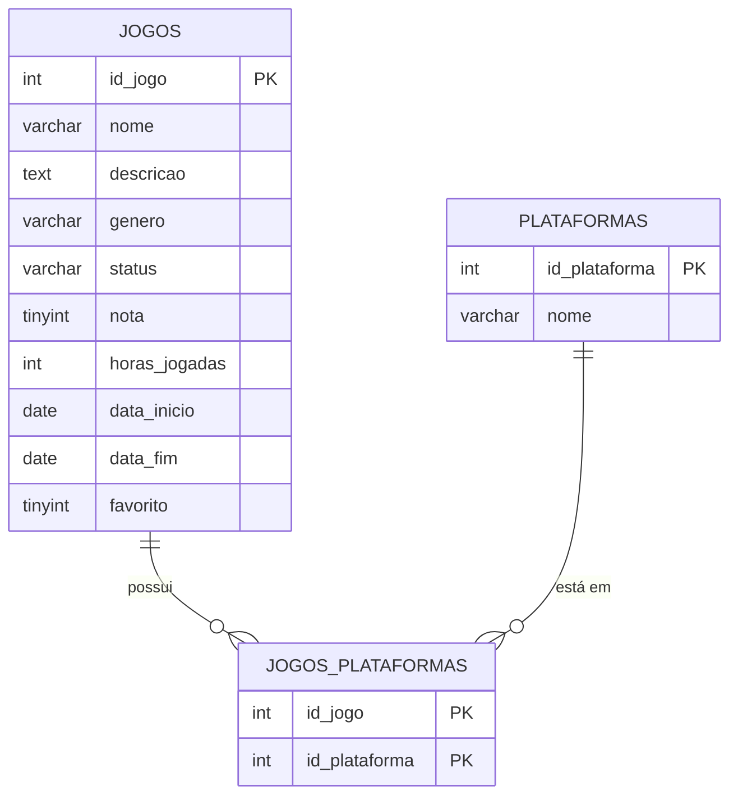

# 🎮 Minha Lista de Jogos

Aplicação web para organizar a sua coleção de jogos, inspirada no MyAnimeList. O usuário cadastra os jogos manualmente, acompanha o status de cada um (jogando, zerado, na fila ou abandonado), dá notas, registra as horas jogadas e consulta estatísticas da coleção.

O projeto é composto por uma **API REST em PHP** e por um **front-end em PHP, HTML e CSS** que consome essa API. O front-end não acessa o banco de dados: toda a comunicação passa pela API.

> Trabalho acadêmico, feito exclusivamente com PHP, HTML, CSS e MariaDB (sem JavaScript e sem frameworks).


[Tela inicial](docs/tela-inicial.png)
[Formulário de Adição de Jogos](docs/formulario.png)
[Tela de Estatísticas](docs/estatisticas.png)


## ✨ Funcionalidades

- Lista de jogos em cards, em ordem alfabética
- Filtro por status: **Todos**, **Jogando**, **Planejo Jogar**, **Zerado** e **Abandonado**
- Busca por nome do jogo
- Ordenação por nome ou por nota, mantendo os filtros ativos
- Cadastro, edição e exclusão de jogos
- Tela de detalhes de cada jogo
- Um jogo pode estar em várias plataformas (PC, PlayStation, Xbox, Switch, Mobile)
- Marcação de jogos favoritos
- Página de estatísticas (total de jogos, zerados, favoritos, horas totais, média de horas e nota média)
- Mensagens de sucesso após adicionar, editar e excluir
- Documentação interativa da API com Swagger UI

## 🛠️ Tecnologias

| Camada | Tecnologia |
|---|---|
| Back-end | PHP 8.1+ (PDO) |
| Banco de dados | MariaDB (embutido no XAMPP) |
| Front-end | PHP, HTML e CSS |
| Comunicação front → API | cURL |
| Documentação | OpenAPI 3.0 + Swagger UI |
| Servidor local | XAMPP (Apache) |

## 🏗️ Arquitetura

```
Navegador  →  páginas PHP (front-end)  →  API REST (tarefas.php)  →  MariaDB
                     └── cliente.php (cURL)
```

As páginas do front-end chamam a API pela função `chamar_api()` (em `cliente.php`), que monta a requisição HTTP com cURL. Só a API usa o banco de dados.

## 📁 Estrutura do projeto

```
jogos/
├── api/
│   ├── config.php        # conexão com o banco (PDO)
│   ├── tarefas.php       # API REST (GET, POST, PUT, DELETE)
│   ├── openapi.yaml      # especificação OpenAPI
│   └── docs.html         # documentação (Swagger UI)
├── cliente.php           # funções do front-end (chamar_api, h, avisos)
├── database.sql          # criação do banco, tabelas e dados de exemplo
├── index.php             # lista de jogos, filtros, busca e ordenação
├── adicionar.php         # formulário de cadastro
├── editar.php            # formulário de edição
├── detalhes.php          # detalhes de um jogo
├── estatisticas.php      # estatísticas da coleção
└── style.css             # estilos
```

## 🗄️ Banco de dados



A relação entre jogos e plataformas é **muitos-para-muitos**, resolvida pela tabela `jogos_plataformas` (chave primária composta e `ON DELETE CASCADE`).

## 🚀 Como executar

**Pré-requisitos:** [XAMPP](https://www.apachefriends.org/) com PHP 8.1 ou superior (a extensão cURL já vem habilitada).

1. Copie a pasta do projeto para `htdocs`, com o nome `jogos` (`C:\xampp\htdocs\jogos`).
2. No painel do XAMPP, inicie o **Apache** e o **MySQL/MariaDB**.
3. Abra o phpMyAdmin (`http://localhost/phpmyadmin`), vá na aba **Importar** e importe o arquivo `database.sql`. Isso cria o banco `jogos`, as tabelas e alguns dados de exemplo.
4. Acesse a aplicação em **http://localhost/jogos/**.
5. A documentação da API fica em **http://localhost/jogos/api/docs.html** (precisa de internet, pois o Swagger UI é carregado por CDN).

> A conexão usa o padrão do XAMPP (usuário `root`, sem senha). Se o seu ambiente for diferente, ajuste o arquivo `api/config.php`.

## 📡 Endpoints da API

URL base: `http://localhost/jogos/api/tarefas.php`

| Método | Parâmetros | Descrição |
|---|---|---|
| `GET` | `status`, `buscar`, `ordem` (opcionais) | Lista os jogos, com filtro, busca e ordenação |
| `GET` | `id` | Retorna um jogo |
| `GET` | `plataformas=1` | Lista as plataformas cadastradas |
| `GET` | `generos=1` | Lista os gêneros aceitos |
| `GET` | `estatisticas=1` | Retorna as estatísticas da coleção |
| `POST` | corpo JSON | Cria um jogo |
| `PUT` | `id` + corpo JSON | Atualiza um jogo |
| `DELETE` | `id` | Remove um jogo |

Exemplo de cadastro:

```bash
curl -X POST http://localhost/jogos/api/tarefas.php \
  -H "Content-Type: application/json" \
  -d '{"nome":"Hollow Knight","genero":"Puzzle e Plataforma","status":"Jogando","nota":9,"plataformas":[1,6]}'
```

Resposta (`201`):

```json
{ "id": 4, "mensagem": "Jogo criado" }
```

### Regras de validação

A API valida tudo antes de gravar e responde `422` com a mensagem do primeiro problema encontrado.

| Campo | Regra |
|---|---|
| `nome` | obrigatório, até 60 caracteres |
| `genero` | um dos 10 gêneros aceitos |
| `status` | `Planejo Jogar`, `Jogando`, `Zerado` ou `Abandonado` |
| `nota` | opcional, inteiro de 0 a 10 |
| `horas_jogadas` | opcional, inteiro maior ou igual a 0 |
| `plataformas` | obrigatório, pelo menos uma, com ids existentes |
| `data_inicio` | opcional (padrão: hoje), formato `AAAA-MM-DD`, não pode ser futura |
| `data_fim` | só com status `Zerado`; não pode ser futura nem anterior ao início |
| `favorito` | apenas no `PUT`: `0` ou `1` |

Se o status for `Zerado` e a `data_fim` não for enviada, a API usa a data de hoje.

### Códigos de resposta

`200` sucesso · `201` criado · `400` id não informado · `404` não encontrado · `405` método não permitido · `422` dados inválidos · `500` erro interno

## 🔒 Decisões técnicas

- **Prepared statements** (PDO) em todas as consultas, contra SQL Injection
- **Transações** no cadastro e na edição, para o jogo e os vínculos com as plataformas serem gravados juntos ou não serem gravados
- **Validação na API**, sem depender do front-end
- **Lista de ordenações permitidas** (whitelist), já que o `ORDER BY` não aceita parâmetros
- **Escape de saída** (`htmlspecialchars`) no front-end, contra XSS
- **Post/Redirect/Get** nos formulários, para não reenviar dados ao atualizar a página

## 👤 Autor

**João** — [@JgSantos12](https://github.com/JgSantos12)
